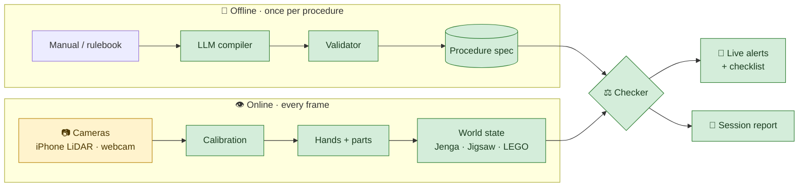

<div align="center">

# 🧩 ThirdEye

### Catch mistakes in a procedure *as they happen*, from video, with rules an LLM reads from the manual.


[How it works](#how-it-works) · [Architecture](#architecture) · [Quick start](#quick-start) · [Status](#status) · [Roadmap](#roadmap)

</div>

---

## ✨ What it does

Someone plays **Jenga** or builds a **jigsaw** in front of a camera. ThirdEye follows along and
flags the moment they break the procedure:

| 🚫 Alert | Example |
| :-- | :-- |
| **Illegal move** | Pulling a block from the top complete layer |
| **Out of order** | Filling the middle before the border is done |
| **Missed step** | Finishing with a gap nobody filled |
| **Wrong part** | Putting in a piece that belongs somewhere else |
| **Wrong position / rotation** | Right piece, wrong spot or turned the wrong way |

You don't write any rules by hand. Give it the **manual or rulebook as text**, and an LLM turns
it into the rules the checker enforces.

---

<a id="how-it-works"></a>

## 💡 How it works

<table>
<tr>
<td width="33%" valign="top">

### 📖 Read
**LLM compiler**, offline, once per procedure

Turns the manual into a *procedure spec*: what must be true before each move, and what the move
should change.

</td>
<td width="33%" valign="top">

### 👁️ Watch
**Computer vision**, every frame

Tracks hands and parts and keeps a live *world state*: which Jenga slots are full, which jigsaw
cells are filled.

</td>
<td width="33%" valign="top">

### ⚖️ Judge
**Deterministic checker**

Compares what the camera sees against the spec. Every alert comes from an explicit rule, never
from the LLM.

</td>
</tr>
</table>

> [!NOTE]
> **The LLM never sees video.** It only reads text: it compiles the manual, and later explains
> the session. All visual judgement is made by CV models, and every alert can be traced back to
> the rule that raised it.

---

## 🎯 Procedures

| | Procedure | Status | Why it's a good test |
| :-: | :-- | :-: | :-- |
| 🟫 | **Jenga** | 🟢 Active | **No step order, only rules.** Tests whether the system handles constraints, not just sequences. All blocks look alike, so any failure is a reasoning failure, not a detection one. |
| 🧩 | **Jigsaw** | 🟢 Active | **A grid of pieces.** Pieces are identified by matching against the box picture, so no training is needed. Its instructions are written as ordered steps (corners → edges → interior). |
| 🧱 | **LEGO** | ⏸️ Parked | The original demo. Code and tests are kept; set aside for now. |

### 📷 Hardware

- **Jenga:** an iPhone Pro with **LiDAR** at one corner of the tower (colour + depth), plus a
  second camera at the opposite corner. Depth makes empty and pushed-out slots easy to see even
  though every block is the same colour.
- **Jigsaw:** one overhead **webcam** above a board with printed ArUco markers at the corners.

---

<a id="architecture"></a>

## 🏗️ Architecture



<div align="center"><sub>🟩 built (tested on synthetic input)&nbsp;&nbsp;·&nbsp;&nbsp;🟨 needs real hardware</sub></div>

<details>
<summary><b>🔍 Design details</b></summary>

<br>

**One checker for every procedure.** The world state is an interface (`state/base.py`) with one
implementation per procedure. The checker never asks which one it has, so adding a new procedure
means writing a state tracker. The checker and compiler stay the same.

**Two kinds of spec:**

| Form | For | Looks like |
| :-- | :-- | :-- |
| `DagSpec` | Ordered procedures (jigsaw steps, LEGO) | Steps with parts, poses and dependencies |
| `ConstraintSpec` | Rule-based procedures (Jenga) | Actions with preconditions on the current state |

Both are lowered to the same list of actions with preconditions, so the checker has a single
code path.

**Safe rules.** Preconditions are small expressions like `src.layer < top_layer`. They're checked
against a whitelist when the spec is compiled and evaluated by an AST walker. There is no
`eval` anywhere.

**No guessing.** When the camera can't see enough to judge a move, the checker waits for a
clearer view instead of raising an alert. An alert is a claim about the user, so it never comes
from a failure of our own.

</details>

---

<a id="quick-start"></a>

## 🚀 Quick start

**1. Install** (Python 3.11+)

```bash
uv venv && source .venv/bin/activate
uv pip install -e ".[dev]"      # core + tests
```

<details>
<summary>Optional extras</summary>

```bash
uv pip install -e ".[live]"     # camera path: torch, ultralytics, mediapipe
uv pip install -e ".[llm]"      # LLM compiler: anthropic SDK
./scripts/fetch_models.sh       # MediaPipe hand model → models/
```

</details>

**2. Run the tests**, no hardware needed

```bash
pytest
```

**3. Replay a Jenga game** through the real tracker and checker

```bash
python -m thirdeye.replay scripts/scenarios/jenga_fouls.yaml
```
```text
jenga_game: 6 moves judged, 6 alerts, 0 warnings
  ended: game_over
```

**4. Replay a jigsaw run** with a planted error, then watch it in a browser

```bash
python -m thirdeye.replay scripts/scenarios/jigsaw_forest_12_interior_early.yaml
python -m thirdeye.server.app            # http://127.0.0.1:8000/ , pick a session, press Start
```

**5. Run from a config** (`configs/`), and reproduce the numbers

```bash
python -m thirdeye.run configs/replay_jenga.yaml     # no hardware
python -m eval.run_scenarios                         # precision / recall / false alerts per procedure
python -m eval.compiler_eval --oracle                # the 16-source compiler corpus (ground truth scores 1.0)
python -m eval.latency                               # per-stage latency vs the budget
python -m thirdeye.explain.report game.json          # session report from a --log file
```

**6. Compile a manual into a spec**

```bash
export ANTHROPIC_API_KEY=...
python -m thirdeye.compiler.compile manuals/jigsaw_forest_12.txt --kind jigsaw -o specs/jigsaw.compiled.json
python -m thirdeye.compiler.compile manuals/jenga_rules.txt --kind constraints -o specs/jenga.compiled.json
```

> [!TIP]
> Scenario scripts describe the *scene* over time (what's on the table, where the hands are),
> not the events, so the replay exercises the same code a live camera does. Generate one per
> planted error with `scripts/make_scenarios.py`.

<details>
<summary><b>🧱 LEGO live camera (parked)</b></summary>

```bash
python scripts/make_markers.py markers.png       # print at 100%, tape at the plate corners
python -m thirdeye.live --spec specs/model_a.json --zero-shot
python -m thirdeye.live --spec specs/model_a.json --zero-shot --video run.mp4 --no-show --log run.json
```

</details>

---

<a id="status"></a>

## 📊 Project status

> [!IMPORTANT]
> "Built" below means implemented and tested on **synthetic input drawn by this repository** (a ray-cast
> tower, a drawn jigsaw board, scripted replays). Nothing has yet run on a real iPhone, a real webcam,
> real pieces, or against a real LLM. See [the plan, Section 6](docs/ThirdEye_Project_Plan.md) for what
> that does and does not show.

| Component | | Notes |
| :-- | :-: | :-- |
| Spec schema + validator | ✅ | Three forms: LEGO and jigsaw (dependency), Jenga (constraint) |
| LLM compiler | ✅ | Structured output + one repair round; **not yet run with a real model** |
| Checker engine | ✅ | One loop for every spec form; Jenga, jigsaw and LEGO rule sets |
| Jenga lattice + collapse detection | ✅ | |
| Jenga slot reading from depth | 🟡 | Diagonal-corner, two cameras merged, unobserved slots held. Synthetic depth only |
| RGB-D input | 🟡 | Recorded frames work; the Record3D live source is written but untested on a phone |
| Camera pose, clock offset | 🟡 | Pose from table markers; cross-correlation offset. Synthetic only |
| Jigsaw state + piece matching | 🟡 | Tracker, box-picture matcher (margin, unidentified), board view. Synthetic pieces only |
| Calibration + hand tracking | ✅ | ArUco homography; MediaPipe wrapper not run here (package absent) |
| Session log + scripted replay | ✅ | 26 scenarios, all three procedures |
| Server + web UI | ✅ | FastAPI + WebSocket (schema v1), single-file browser UI; React app not built |
| Session report | ✅ | Plain (offline) or LLM-written; LLM path untested |
| Evaluation scripts | 🟡 | Metrics, scenario / compiler / latency / ablation scripts; **no real-data numbers** |
| Compiler eval corpus | ✅ | 16 sources + ground truth; no model output scored yet |
| Step recognizer | 🟡 | MS-TCN, EV-SEG-1 metrics, data layout, occlusion hints; no benchmark run |
| Recordings, labels, public datasets | ⬜ | Needs the rig |

---

<a id="roadmap"></a>

## 🗺️ Roadmap

<details open>
<summary><b>🟫 Jenga</b></summary>

- [x] Jenga rulebook text → hand-built spec (`manuals/jenga_rules.txt`, `specs/jenga.json`)
- [x] Diagonal-corner mode for the lattice, with two cameras merged
- [x] Empty, pushed-out and unobserved slot detection from depth (synthetic)
- [x] RGB-D input: recorded frames; Record3D source written
- [ ] Compile the rulebook with a real model and score it
- [ ] Stream colour + depth from the iPhone (Record3D) and tune thresholds on real clips
- [ ] Record and label real games

</details>

<details open>
<summary><b>🧩 Jigsaw</b></summary>

- [x] Jigsaw spec: grid, pieces, ordered steps and rules
- [x] Piece-grid state tracker
- [x] Piece position + rotation by matching against the box picture
- [x] Jigsaw instructions → spec (`manuals/jigsaw_forest_12.txt`, hand-built; compile run pending)
- [ ] Try it on a real puzzle: glare, shadows, hands
- [ ] Record and label real runs

</details>

<details>
<summary><b>🔧 Shared</b></summary>

- [x] Step recognizer (`temporal/`): model, metrics, data layout (no benchmark yet)
- [x] LLM session report (`explain/`)
- [x] FastAPI + WebSocket server and browser UI
- [x] Evaluation scripts: precision/recall per error, false alerts per run, compiler corpus, latency
- [ ] React UI
- [ ] Run the evaluation on real data and a public benchmark
- [x] Update `docs/` to the current direction

</details>

<details>
<summary><b>🔭 Later</b></summary>

- [ ] Read picture-only instructions (official LEGO booklets) with a vision model: step order
      and parts from the pages, positions from LDraw files or one demonstrated build

</details>

---

## 📁 Repository layout

<details>
<summary>Show tree</summary>

```
thirdeye/
├── compiler/      📖 schema · validator · safe expressions · LLM compiler · jigsaw spec builder
├── perception/    👁️ calibration · hands · camera model · RGB-D · slot reading · piece matching · board view
├── state/
│   ├── base.py       WorldState interface
│   ├── jenga/        tower lattice · collapse detection
│   ├── jigsaw/       piece grid
│   └── lego/         stud grid · build tracker   (parked)
├── checker/       ⚖️ engine · expression evaluator · rule sets (Jenga, jigsaw, LEGO)
├── temporal/      step recognizer: MS-TCN · metrics · occlusion hints
├── explain/       session report
├── server/        FastAPI · WebSocket schema · browser UI
├── session.py     joins a tracker and the checker for one run
├── sessionlog.py  JSON log, the report's only input
├── replay.py      scripted sessions through the real pipeline
├── run.py         run a procedure from a YAML config
└── live*.py       camera in, alerts out (jigsaw, Jenga, LEGO)
eval/              metrics · scenario, compiler, latency and ablation scripts · synthetic scenes
configs/           YAML per procedure / rig
specs/             procedure specs (JSON)
manuals/           text manuals and rulebooks · eval_corpus/ (16 sources + ground truth)
scripts/           markers · scenario / spec / corpus generators · model fetch
tests/             unit + scenario + end-to-end tests
docs/              project plan + requirements
```

Not yet built: `ui/` (the React app; a single-file browser UI ships in `thirdeye/server/static/`).

</details>

---

## 📚 Documentation

| | |
| :-- | :-- |
| 📋 [Project plan](docs/ThirdEye_Project_Plan.md) | Problem, architecture, timeline, risks |
| ✅ [Requirements](docs/ThirdEye_Requirements.md) | Numbered requirements, the `FR-*` / `NFR-*` IDs cited in the code |

> [!NOTE]
> Both documents were rewritten on 2026-10-12 for the Jenga + jigsaw direction. LEGO requirements are
> marked parked, not deleted, because the code still cites their IDs. The PDFs in `docs/` are stale
> until regenerated (see `docs/README.md`).
