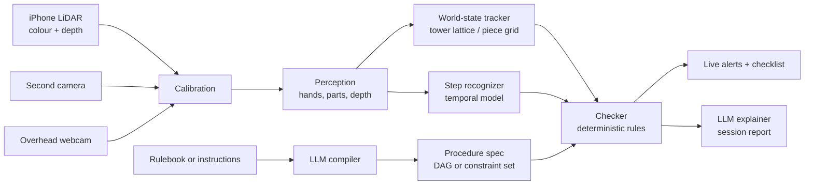

# ThirdEye: Real-Time Detection of Procedural Errors from Video Using LLM-Generated Task Graphs

Plan revised 2026-10-12 (supersedes the LEGO-first plan of 2026-09-18) · Week numbers count from the week of 2026-09-14, so this revision is written in week 5.

**Status, 2026-10-14:** the software side of every must-have is built and tested against *synthetic* input; nothing has yet touched real hardware or real video. Section 6 has the item-by-item status, and says for each what "built" does and does not show.

ThirdEye watches someone follow a procedure through a camera and flags missed, out-of-order or wrongly executed steps in real time. It uses a machine-readable procedure spec that an LLM compiles from any written source — an instruction sheet or a rulebook.

Two demo procedures, chosen to be different in kind rather than different in decoration:

- **Jenga** — a rulebook compiles to a **constraint set** with no fixed order. Seen by an iPhone LiDAR camera plus a second camera at the opposite corner of the tower.
- **Jigsaw** — instructions compile to a **dependency graph** (corners, then edges, then interior). Seen by one overhead webcam over a marked board.

**LEGO assembly is parked.** It was the original must-have and is why the checker, the stud grid and the live camera path exist. The code and its tests are kept and kept green, but no new LEGO work is planned. Section 1.3 records why the plan changed.

---

## 1. Problem and goal

Most procedural errors are omissions or wrong order, not wrong motions, and usually nobody is watching when they happen. This is true in lab work, clinical routines like hand hygiene, and manual assembly lines.

Existing systems either classify single actions or need a custom model per task. ThirdEye separates the two concerns:

- **Language side (the thread):** an LLM reads a rulebook or instruction sheet and compiles it into a *procedure spec*: what must be true before an action is legal, and what each action should change in the scene.
- **Vision side (the eyes):** CV models track hands and parts and keep a live *world state* of the physical scene.
- **Checker (the judge):** a deterministic engine compares what the camera saw against the spec and raises alerts: *missed step*, *out of order*, *wrong part*, *wrong position or rotation*, *illegal move*.

### 1.1 Why these two procedures

**Jenga** is deliberately awkward for a step-list design, in three useful ways:

- **The procedure has no step order.** The rulebook states invariants — never take from the top complete layer or above, finish a layer before starting the next, one hand at a time. The compiler must emit *preconditions on an action*, not a sequence. A system that only handles ordered manuals cannot do Jenga at all.
- **The state is vertical.** An 18 × 3 slot lattice, not a flat grid, so the state model has to be an interface rather than a hard-coded structure.
- **The part vocabulary is trivial.** One block class, uniform colour. A failure on Jenga is therefore a *reasoning or state* failure, never a detection failure — a clean test of the part of the system we claim as a contribution.

It is also the better live demo: a panel member plays a game and the system calls fouls in real time.

**Jigsaw** is the ordered-procedure counterpart, and it is cheap in a way LEGO was not:

- **No part detector to train.** Pieces are identified by matching them against the picture on the box, so there is no labelled-frame budget and no colour/size vocabulary to get wrong.
- **A grid of pieces.** The board is a flat grid of cells, so height is never a problem. This removes the single biggest risk of the LEGO plan (layer inference from a top-down view).
- **Its instructions are ordered steps** (corners → edges → interior), which exercises the dependency-graph form and the *out of order* and *missed step* errors.
- **Errors are easy to stage:** a piece in the wrong cell, a piece turned the wrong way, an interior piece placed before the border is done.

### 1.2 Generality claim, stated precisely

The earlier framing — "nothing is LEGO-specific except the object vocabulary" — was too strong. The honest claim is a ladder, and each rung is a separately reportable result:

| Tier | What is new | What is reused | Result it supports |
| --- | --- | --- | --- |
| 1 | **Jenga game**: a procedure with no order, only constraints; a vertical state | The checker and the compiler | The spec format, not just the weights, is general |
| 2 | **Jigsaw**: an ordered procedure, a new state model and a new identification method (matching, not a trained detector) | The same checker, the same spec lowering | Adding a procedure means writing a state tracker and nothing else |
| 3 | **Unseen manual**: a second jigsaw, or a second rulebook, compiled with no code change | Everything | Compiler and checker generalise across instances |

The earlier ladder put an unseen LEGO model first. LEGO is now a *prior* result rather than a rung: it is the third state model the interface was exercised against, and it shows the checker never needed to change when the procedure did.

**Goal for the semester:** live rule enforcement on Jenga from a rulebook alone, live step checking on a jigsaw from its instructions alone, a measured compiler accuracy over a text corpus, and a benchmark result for the step recognizer on a public procedural-error dataset.

### 1.3 Why the plan changed

- **LEGO needed a trained detector and could not see height.** It needed 300–600 labelled frames per brick vocabulary, and a top-down camera cannot see layers. The plan carried that as its highest risk and spent a side camera and a week of integration on it.
- **Jenga was always the stronger result.** The old plan gated it behind the LEGO must-have. The checker, lattice and collapse detection for it are already built, and it needs no detector training.
- **A depth camera changes the Jenga problem.** An iPhone LiDAR stream makes empty and pushed-out slots visible in a scene where every block is the same colour. That makes it practical to stop assuming two straight-on side views.
- **Nothing was thrown away.** The checker, compiler and state interface are procedure-agnostic by construction, which is the point of the project. LEGO is simply no longer the thing we are building next.

---

## 2. System architecture

There is an offline path (the written procedure becomes a spec, once per procedure) and an online path (video becomes events and world state, continuously). The checker is where they meet.



The LLM never sees raw video. It works only with text: it compiles the procedure and explains the alerts. All visual judgment comes from CV models, and every alert comes from an explicit rule.

### 2.1 LLM procedure compiler (offline)

Two compilation targets, one output interface. **Built and tested** for the jigsaw and LEGO dependency forms and the Jenga constraint form. The Jenga rulebook (`manuals/jenga_rules.txt`), the jigsaw sheet (`manuals/jigsaw_forest_12.txt`) and a 16-source eval corpus are committed, with hand-built specs under `specs/`; **compiling them with a real model has not been run** (no API key in the build environment), so compiler accuracy is still unmeasured.

**Target A — constraint set (Jenga).**

- **Input:** the rulebook text.
- **Output:** a single `MOVE` action schema with preconditions and effects, plus terminal conditions (Section 4.3).
- The checker evaluates preconditions against the observed state on every detected move.

**Target B — dependency graph (jigsaw; LEGO is the existing instance).**

- **Input:** a text instruction sheet, one instruction per step (e.g. "Place the four corner pieces first", expanded to one step per piece).
- **Output:** JSON matching the schema in Section 4.2: a piece id, a target cell and rotation, dependencies and an expected duration.
- **Dependencies:** the LLM records stated order. A jigsaw piece has no physical support dependency on another piece, so `hard_depends_on` is normally empty and every dependency is *soft*; order violations are real user errors.

**The DAG is a special case of the constraint form.** Step *k*'s precondition is "all of `soft_depends_on` are done". The constraint form is the checker's native interface and DAG preconditions are generated from it, so both procedures run through identical code. This is a design contribution worth one paragraph in the report, and it is what makes adding jigsaw a state-tracker job rather than a checker job.

**Validation:** schema check, cycle check, collision check (two parts in the same cell), support check (for stacked parts only) and, for constraint specs, a satisfiability check (at least one legal move exists from the initial state). Precondition expressions are drawn from a fixed predicate vocabulary, checked against a whitelist when compiled and evaluated by an AST walker; there is no `eval`. One automated repair round is allowed on a validation failure.

**Fallback, "teach by demonstration":** perform the procedure once correctly in front of the camera and the system records the state after each action. Needed only if compiled specs prove unreliable.

### 2.2 Calibration and cameras

**Jenga rig.**

- **iPhone Pro with LiDAR** at one corner of the tower, streaming colour and depth (Record3D). A **second camera** sits at the opposite corner.
- Depth is the point: every block is the same colour, so a pushed-out or missing block is hard to see in colour but obvious as a change in distance.
- **Diagonal-corner mode.** From a corner a camera sees two faces of the tower at an angle, not one face straight on. Each camera therefore contributes two faces, and the two cameras are merged. Every slot is visible end-on from at least one face of one camera. This replaces the earlier assumption of two orthogonal straight-on side views, which the lattice code originally made (Section 6, ASM-4). The slot reader now works in diagonal-corner mode (`perception/tower_view.py`), so the tracker no longer depends on that assumption; whether it holds on a real LiDAR is untested.
- Markers on the table around the tower base plus the known block size (75 × 25 × 15 mm) give scale.

**Jigsaw rig.** One overhead **webcam** above a board with printed **ArUco markers** at the four corners. OpenCV detects them and computes a **homography** from pixels to board-cell coordinates, so a piece lands on the grid whatever the camera angle. (This is the same calibration code the LEGO stud grid uses.)

### 2.3 Perception (online, per frame)

- **Hands:** MediaPipe Hands keypoints; hand-over-workspace, grasp, and hand-count detection (hand count is a Jenga rule).
- **Jenga slots:** occupancy and push-out per slot, from depth with a colour cue. One block class, so no classifier and no pose regression.
- **Jigsaw pieces:** segment the pieces on the board, then identify each by **matching against the box picture** — which cell it belongs to and at what rotation. No training; the box picture is the only reference. A piece that matches nothing well is reported as unidentified, never guessed.
- **Tracking:** keeps part identities stable so we know which part moved where.
- **Occlusion handling:** while a hand covers the workspace, the state is frozen and only updated once the hand leaves.
- **No guessing:** when the camera cannot see enough to judge a move, the checker waits for a clearer view instead of raising an alert. An alert is a claim about the user, so it never comes from a failure of our own.

### 2.4 World-state tracker

An interface (`state/base.py`) with one implementation per procedure. All expose the same thing to the checker: a current state, and a diff against the previous state.

**Jenga — tower lattice (built).**

- An 18 × 3 occupancy array plus per-layer orientation (alternating 90 degrees, derived rather than observed).
- Events are `REMOVE (layer, slot)` and `ADD (layer, slot)`, joined by a pairer into a single `MOVE`, plus `COLLAPSE` as a terminal event (a large single-frame drop in tower height).
- **Preconditions are judged against the state before the move.** The tracker freezes while hands occlude the tower and updates after, so by the time a move reaches the checker the tower has already changed. Judging "finish a layer before starting the next" against the new state would clear every violation of it.
- The lattice is filled from depth and two diagonal views by `perception/tower_view.py`: each slot has up to two end-on windows, residuals against the face plane decide occupied / empty / pushed out / unobserved, and an unobserved slot keeps its previous belief so no event is invented. Built and tested on a ray-cast synthetic tower only.

**Jigsaw — piece grid (built).**

- A `cols × rows` occupancy of cells, each holding the identified piece and its rotation (or unidentified, or empty).
- A piece counts as placed when it has sat still in a cell for about 0.5 s after a hand leaves.
- Events are `ADD piece @ (col, row, rot)` and `REMOVE`, in the same event schema as the other trackers.
- Height is not modelled; there is nothing to stack.
- Unidentified pieces occupy their cell but emit no event (FR-JIG-4). Implemented in `state/jigsaw/piece_grid.py`.

**LEGO — stud grid (built, parked).** A list of placed bricks `(type, x, y, layer, rotation)` with the same stability filter and diff.

### 2.5 Step recognizer (online, per window)

**Scope decision:** a **benchmark-only track**, time-boxed to two weeks. It is not on the live critical path for either demo. It exists to (a) produce a published-comparison table on a public dataset and (b) one thing the state tracker genuinely cannot do: act during occlusion.

- Clip-level features from a pretrained video encoder (VideoMAE or I3D) plus perception features (hand positions, part-in-hand).
- A temporal action segmentation model (MS-TCN++, ASFormer as the alternative) labels each moment with a generic verb: `search`, `grasp`, `place`, `adjust`, `remove`, `idle`.
- **The one live job worth keeping:** the state tracker is blind while hands occlude the workspace, which is exactly when a Jenga block is touched and released or a jigsaw piece is picked up and put back. The testable hypothesis is that the temporal model recovers errors that begin and end inside an occlusion window.
- For the public benchmarks (Assembly101 / EgoPER) the step recognizer works alone.
- **Cut first.** If the schedule slips, this module is the first to be dropped.

### 2.6 Checker (online, rules)

Each step is `pending`, `active`, `done` or `error`. On every event the checker evaluates the preconditions of the matching action. One engine loop serves both spec forms.

**Jenga error types**

- **Illegal source layer:** a block removed from the top complete layer or above.
- **Layer started early:** a block placed on a new top layer while the layer below is incomplete.
- **Two-handed move:** both hands in contact during a removal.
- **Wrong replacement:** a block returned to a slot other than a legal top-layer slot.
- **Collapse:** terminal; the session ends and the report reconstructs the last few moves.

**Jigsaw error types**

- **Out of order:** a piece placed while a piece it softly depends on is still pending (an interior piece before the border is done).
- **Missed step:** a required piece is still missing when the session ends, or a skip is implied.
- **Wrong part:** a piece occupies a cell that belongs to a different piece.
- **Wrong position / rotation:** the right piece in the wrong cell, or turned the wrong way.
- **Extra / removed part:** a placement matching no step, or removal of a piece from a done step.

**Hard-dependency violations are not user errors.** If a dependency is physically necessary, then observing its violation means *our perception is wrong*, and alerting the user accuses them of a mistake they did not make. Such violations go to an internal re-verification path (Section 4.4), never straight to the user. For Jenga, the same principle means an event the tracker cannot match is a gap in our state, not a foul.

**Soft warnings:** events below a confidence threshold produce a yellow warning, not a red alert, to keep false alarms down. The false-alarm budget is an explicit target (Section 7), not just an ablation.

### 2.7 Interface and explainer

- **Live view:** video with a lattice overlay and a live legality panel (Jenga), or a grid overlay, piece boxes and a checklist that ticks off as steps are completed (jigsaw); red and yellow alerts; a "ghost" of the next expected piece.
- **After the session:** the LLM turns the event log into a readable report (e.g. "At 03:10 you pulled from layer 16, one below the top complete layer — illegal", or "At 01:42 you placed an interior piece before the border was finished").

---

## 3. Tech stack and models

Everything is Python; only small models are trained (if any), so one consumer GPU or free Colab/Kaggle GPUs are enough. The pivot removes the one large labelling task (the LEGO brick detector).

| Module | Primary choice | Fallback / alternative | What we train |
| --- | --- | --- | --- |
| Calibration | OpenCV ArUco + homography | Manual 4-corner click | Nothing |
| Colour + depth input | Record3D stream from the iPhone | Recorded RGB-D files | Nothing |
| Hands | MediaPipe Hands | MMPose hand models | Nothing |
| Jenga slot occupancy | Depth thresholds + a colour cue | A small classifier on slot crops (~150 frames) | Possibly |
| Jigsaw piece identification | Matching against the box picture (feature or template matching) | A small learned embedding | Nothing |
| Tracking | ByteTrack | SORT | Nothing |
| World state | Own lattice / grid modules (NumPy) | — | Nothing |
| Video features | VideoMAE or I3D (precomputed) | DINOv2 per-frame features | Nothing |
| Step segmentation | MS-TCN++ | ASFormer | Yes (benchmark track) |
| LLM (compiler, explainer) | Claude via API | Local Qwen or Llama via Ollama | Nothing; prompt + JSON schema |
| Checker | Plain Python engine | — | Nothing |
| Backend | FastAPI + WebSocket streaming | — | — |
| Frontend | React | Streamlit for early versions | — |
| Labelling | CVAT (step segments, slot states) | Label Studio | — |
| Experiment tracking | Weights & Biases | TensorBoard | — |

### 3.1 Latency budget

Per-frame budget at a 15 FPS target (66 ms/frame), to be measured on the demo laptop in week 6. The stage list changes from the LEGO plan: depth parsing and slot reading replace YOLO as the main per-frame cost, and piece matching runs only on hand-exit, not every frame.

| Stage | Cadence | Budget |
| --- | --- | --- |
| Frame + depth decode (Record3D) | every frame | ≤ 8 ms |
| Jenga slot reading, two cameras | every frame | ≤ 15 ms |
| MediaPipe Hands | every frame | 5–10 ms |
| Tracking | every frame | < 2 ms |
| Homography refresh | every 10 frames | < 1 ms amortised |
| Jigsaw piece matching | on hand-exit only | ≤ 100 ms, off the per-frame path |
| State update + diff | on hand-exit | < 1 ms |
| Checker | per event | < 1 ms |
| **Per-frame total (Jenga)** | | **≤ 40 ms (leaves 26 ms headroom)** |
| Temporal model | every 0.5 s, async | ≤ 200 ms, off the critical path |
| WebSocket overlay push | every frame | ≤ 10 ms |

The temporal model runs asynchronously and never blocks a frame. The demo reads the cameras **locally in the Python process**, pushing only overlays and alerts over the WebSocket.

**Hardware:** an iPhone Pro with LiDAR on a stand at one Jenga corner, a second camera at the opposite corner, an overhead 1080p webcam on a rigid stand for the jigsaw, a Jenga set, a dark backdrop, a jigsaw board with four printed ArUco markers, and a laptop (GPU recommended).

---

## 4. Implementation details

### 4.1 Repository structure

`●` built, `○` to do, `◐` parked (kept, green, no new work). Directories not yet created are noted.

```
thirdeye/
├── manuals/                   # ● model_a.txt · jenga_rules.txt · jigsaw_forest_12.txt
│   └── eval_corpus/           # ● 16 sources + ground-truth specs (j01-09, r01-04, l01-03)
├── specs/                     # ● example_*.json · model_a.json · jenga.json · jigsaw_forest_12.json
├── configs/                   # ● YAML per procedure / rig (python -m thirdeye.run)
├── thirdeye/
│   ├── events.py              # ● event, alert and log schemas
│   ├── session.py             # ● joins a tracker and the checker for one run
│   ├── sessionlog.py          # ● JSON log, the report's only input
│   ├── replay.py              # ● scripted sessions through the real pipeline
│   ├── run.py                 # ● run any procedure from a YAML config
│   ├── live.py                # ◐ camera in, alerts out (LEGO path)
│   ├── live_jigsaw.py         # ● overhead webcam loop (needs a camera; tested on synthetic frames)
│   ├── live_jenga.py          # ● recorded RGB-D loop (Record3D live source: untested on a phone)
│   ├── compiler/
│   │   ├── schema.py          # ● DagSpec, JigsawSpec, ConstraintSpec
│   │   ├── expr.py            # ● safe expression whitelist + evaluator
│   │   ├── validate.py        # ●
│   │   ├── jigsaw.py          # ● hand-built jigsaw specs (corpus ground truth, demo spec)
│   │   └── compile.py         # ● LLM compiler, one repair round (dag | jigsaw | constraints)
│   ├── perception/
│   │   ├── calibrate.py       # ● ArUco + homography
│   │   ├── hands.py           # ● (MediaPipe wrapper not run here: package absent)
│   │   ├── detect.py          # ◐ YOLO part detector (LEGO)
│   │   ├── pipeline.py        # ● (LEGO)
│   │   ├── camera_model.py    # ● pinhole camera, pose from table markers
│   │   ├── depth.py           # ● RGB-D frames, recorded source, Record3D source (untested live)
│   │   ├── sync.py            # ● clock offset between cameras, frame pairing
│   │   ├── tower_view.py      # ● diagonal-corner slot reading from depth, two cameras merged
│   │   ├── jenga_pipeline.py  # ● frames -> lattice -> checker, hand count, collapse gating
│   │   ├── piece_match.py     # ● match pieces against the box picture, margin, unidentified
│   │   ├── board.py           # ● rectify, occupied cells, per-cell readings
│   │   └── jigsaw_pipeline.py # ● frame -> calibrate -> board -> readings
│   ├── state/
│   │   ├── base.py            # ● WorldState interface
│   │   ├── jenga/             # ● lattice.py, collapse.py
│   │   ├── jigsaw/            # ● piece_grid.py
│   │   └── lego/              # ◐ grid.py, build_state.py
│   ├── checker/
│   │   ├── engine.py          # ● constraint-native engine
│   │   ├── evaluate.py        # ● expression evaluator
│   │   ├── match.py           # ●
│   │   ├── rules_jenga.py     # ●
│   │   ├── rules_jigsaw.py    # ●
│   │   └── rules_lego.py      # ◐
│   ├── temporal/              # ● metrics, smoothing, MS-TCN, data layout, occlusion hints (no benchmark run)
│   ├── explain/               # ● report.py: event log -> report (plain, or LLM)
│   └── server/                # ● FastAPI app, WebSocket schema v1, hub, browser UI
├── ui/                        # ○ React app (a single-file browser UI ships in server/static/)
├── eval/                      # ● metrics, scenario / compiler / latency / perception scripts, synthetic scenes
├── scripts/                   # ● make_markers, make_scenarios, make_specs, make_corpus, fetch_models.sh · ○ recording
├── docs/                      # plan + requirements
└── tests/                     # ● 382 tests
```

### 4.2 Procedure spec — dependency form (jigsaw; LEGO shown as built)

The LEGO form below is implemented. The jigsaw form is the same shape with a `piece_grid` state model, `part` replaced by a piece id from the box picture, and `pose` reduced to a cell and a rotation. Extending the schema is a to-do (FR-JIG-1).

```json
{
  "procedure": "jigsaw_forest_12",
  "kind": "dag",
  "state_model": "piece_grid",
  "grid": { "cols": 4, "rows": 3 },
  "steps": [
    {
      "id": "s1",
      "instruction": "Place the top-left corner piece",
      "part": { "piece": "r0c0" },
      "pose": { "col": 0, "row": 0, "rot": 0 },
      "hard_depends_on": [],
      "soft_depends_on": [],
      "optional": false,
      "expected_duration_s": [3, 40]
    },
    {
      "id": "s5",
      "instruction": "Fill the first edge piece along the top",
      "part": { "piece": "r0c1" },
      "pose": { "col": 1, "row": 0, "rot": 0 },
      "hard_depends_on": [],
      "soft_depends_on": ["s1", "s2", "s3", "s4"],
      "optional": false,
      "expected_duration_s": [3, 40]
    }
  ]
}
```

- `hard_depends_on`: physically required (support). For jigsaw this is normally empty. A violation would signal a **detection failure on our side**, not a user error. See Section 4.4.
- `soft_depends_on`: order stated in the instructions (here, all four corners before any edge). Violating it is an **out-of-order** error.

The implemented LEGO form uses `"state_model": "stud_grid"`, a `baseplate`, and `part: {color, size}` with `pose: {x, y, layer, rot}`; see `specs/example_dag.json`.

### 4.3 Procedure spec — constraint form (Jenga)

The rulebook has no steps, so the compiler emits actions with preconditions. The checker's evaluator is written against this form; DAG steps are lowered into it. This is implemented; see `specs/example_constraints.json`.

```json
{
  "procedure": "jenga_game",
  "kind": "constraints",
  "state_model": "tower_lattice",
  "tower": { "layers": 18, "slots_per_layer": 3 },
  "actions": [
    {
      "id": "move",
      "instruction": "Take one block from below the top complete layer and place it on top",
      "preconditions": [
        { "id": "c1", "expr": "src.layer <= top_complete_layer - 1",
          "text": "Do not take from the top complete layer or above",
          "violation": "illegal_source_layer" },
        { "id": "c2", "expr": "hands_in_contact == 1",
          "text": "One hand at a time",
          "violation": "two_handed_move" },
        { "id": "c3", "expr": "dst.layer == top_layer or layer_complete(top_layer)",
          "text": "Finish a layer before starting the next",
          "violation": "layer_started_early" },
        { "id": "c4", "expr": "dst in legal_top_slots()",
          "text": "Place only in a top-layer slot",
          "violation": "wrong_replacement" }
      ],
      "effects": ["occupancy[src] = 0", "occupancy[dst] = 1"]
    }
  ],
  "terminal": [
    { "id": "t1", "expr": "collapse_detected", "outcome": "game_over" }
  ]
}
```

The `expr` strings are evaluated by a small safe interpreter over named state predicates, not by `eval`. The LLM chooses among a fixed predicate vocabulary given in the prompt, which keeps the output checkable.

One known compiler-eval question: c4 as written is broad enough to contain c3, so a layer started early also draws a wrong-replacement alert. Whether the compiled spec should narrow it is measured in the corpus, not papered over in the checker.

### 4.4 Events and the checker loop

```python
Event = {
    "t": 102.4,                  # seconds since session start
    "source": "state" | "temporal",
    "kind": "ADD" | "REMOVE" | "MOVE" | "STEP_START" | "STEP_END" | "COLLAPSE",
    "part": {...},               # procedure-specific; absent for Jenga
    "pose": {...},               # procedure-specific; src/dst slots for a Jenga MOVE
    "confidence": 0.91,
}

def on_event(ev, spec, status, state, alerts):
    if ev["kind"] == "ADD":
        step = match_step(ev, spec, status)            # same part + pose, still pending
        if step is None:
            near = match_part_only(ev, spec, status)
            alerts.add(wrong_position(ev, near) if near else wrong_or_extra_part(ev))
            return

        # Hard deps are physically necessary. A violation means OUR state is wrong,
        # not that the user erred. Never alert here -- re-verify instead.
        unmet_hard = [d for d in step.hard_depends_on if status[d] != "done"]
        if unmet_hard:
            state.request_reverify(unmet_hard)         # forced re-read once hands clear
            return                                     # decision deferred, no alert

        for dep in step.soft_depends_on:
            if status[dep] != "done":
                alerts.add(out_of_order(step, dep, ev))
        status[step.id] = "done"

    elif ev["kind"] == "REMOVE":
        step = step_at_pose(ev, spec, status)
        if step and status[step.id] == "done":
            status[step.id] = "pending"
            alerts.add(removed_part(step, ev))

    elif ev["kind"] == "MOVE":                         # Jenga
        action = match_action(ev, spec)                # one schema; no part identity
        for pre in action.preconditions:               # judged against the state BEFORE the move
            if not evaluate(pre.expr, state.predicates(ev)):
                alerts.add(violation(pre, ev))

def on_reverify(deps, observed, status, alerts, log):
    """Resolves a deferred hard-dependency conflict once the view is clear."""
    for d in deps:
        if observed.supports(d):
            status[d] = "done"                  # the part was there; we missed it
            log.perception_miss(d)              # counted against perception recall, not the user
        else:
            alerts.add(missed_step(d))          # genuinely absent: a real skip
```

At the end of a session, every non-optional step still `pending` becomes a **missed step** alert. Perception misses recorded by `on_reverify` are reported separately in the evaluation as a perception recall failure — they are our error, and counting them honestly is part of the results. The pseudocode is the design; the working implementation is `thirdeye/checker/engine.py`.

### 4.5 Real-time loop

1. The demo process reads the camera(s) directly at 15–30 FPS. (Browser capture remains available for remote use but is not the demo path.)
2. Every frame: depth/colour decode, Jenga slot reading, MediaPipe hands, tracking.
3. Every 10 frames or when the markers move: recompute the homographies.
4. When no hand is over the workspace for about 0.5 s: update the world state, diff to events, run the checker. For jigsaw, piece matching runs here.
5. Every 0.5 s, asynchronously: the temporal model runs on the last few seconds of features. It never blocks a frame.
6. Server pushes overlays, checklist or legality status and alerts over the WebSocket.
7. At session end (or on `COLLAPSE`): the event log goes to the LLM explainer.

### 4.6 Perception development

- **Jenga:** build on recorded RGB-D clips first, live second. Depth gives presence and push-out per slot. Confirm against hand-labelled lattice states before trusting it in the checker. If depth thresholds are not enough, a small slot-crop classifier on ~150 labelled frames is the fallback.
- **Jigsaw:** matching, not training. Build the reference from the box picture split into cells at each of four rotations; identify a piece by the best match, and report the margin to the second-best. A low margin means *unidentified*, which waits and never alerts. Piece segmentation against the board is the main source of error.
- **LEGO (parked):** the fine-tuned YOLO detector stays in `detect.py`, unchanged.

### 4.7 Training the step recognizer

- Precompute features once per video (VideoMAE/I3D) and store as `.npy`, so training runs fast even on a free GPU.
- Train MS-TCN++ on Assembly101 (or EgoPER) for the benchmark.
- Use generic action classes (`grasp`, `place`, `adjust`, `remove`, `idle`) rather than step ids, so the same model transfers between Jenga and jigsaw without retraining. The world-state tracker supplies which step it was.

---

## 5. Datasets

A public dataset gives the benchmark numbers; our own recordings give the demos and the generality results. *Check each public dataset's access, license and size; the descriptions below are from memory and are unverified.*

| Dataset | What it contains | Use in ThirdEye |
| --- | --- | --- |
| Assembly101 | Toy-vehicle assembly and disassembly from multiple views, with fine-grained action and mistake labels | **Primary benchmark** for the step recognizer |
| EgoPER | First-person cooking videos with step labels and deliberate errors | Second benchmark for error detection |
| IndustReal | Assembly of a toy car model, with procedure step and error labels | Stretch: extra assembly benchmark |
| **ThirdEye-JENGA (ours)** | Jenga games with planted rule violations, RGB-D from two corners | Training and tuning of slot reading, live demo, tier-1 result |
| **ThirdEye-JIGSAW (ours)** | Jigsaw runs with planted errors, overhead view | Live demo, tier-2 result |
| **Compiler eval corpus (ours)** | 15–20 written sources + hand-authored ground-truth specs | Compiler accuracy, Section 7 |
| ThirdEye-LEGO (ours, parked) | Whatever LEGO recordings exist | Not extended |

### 5.1 ThirdEye-JENGA

- 15–20 games, 3–4 people, colour + depth from the iPhone and a second camera at the opposite corner.
- **Planted violations:** pull from the top complete layer, start a new layer early, two-handed pull, return a block to an illegal slot. Naturally occurring collapses need no planting.
- **Labels:** move start/end, source and destination slot, violation type, and the lattice state after each move. Cheap to label: a move is a short, visually distinct event and there is no part vocabulary. Budget 10 person-hours.

### 5.2 ThirdEye-JIGSAW

- **Puzzles:** one for development (around 12–24 pieces so a run is short) and one held out for the tier-3 test, both with a box picture. Pick puzzles whose pieces differ visibly; avoid large uniform sky or water areas.
- **Recordings:** 20–30 runs from 3–4 people, about half with planted errors, overhead view only.
- **Planted errors:** skip a piece, interior piece before the border, piece in the wrong cell, piece turned 90/180/270°, piece removed after placement.
- **Labels:** per placement, the cell, rotation and time; error type per run. Budget 10 person-hours.

### 5.3 Compiler eval corpus

Fifteen to twenty short sources never physically built, each with a hand-authored ground-truth spec. Pure text, no recording. Include 3–4 rulebook-style sources so the constraint form is measured, and a handful of jigsaw-style instruction sheets for the dependency form.

This exists because compiling two real documents is not a measurement. The corpus turns the accuracy target into a real table with an error taxonomy (wrong pose, missed dependency, hallucinated step, wrong constraint), and it is the one result that survives independently of whether the vision stack works. **Not started.**

---

## 6. Scope and status

The minimum project is **a Jenga game checked live from a rulebook, and a jigsaw checked live from its instructions**, plus the measured compiler result. Everything else is added only once those work end to end.

### Done

- Spec schema (three forms: LEGO and jigsaw dependency, Jenga constraint), validator, safe expressions; LLM compiler with one repair round for all three.
- Checker engine, one loop for every spec form; Jenga, LEGO and jigsaw rule sets. One alert per violation code per event, so a piece placed before a whole group it should follow is one `out_of_order`, not six.
- Jenga lattice and collapse detection; **slot reading from depth in diagonal-corner mode, two cameras merged, unobserved slots held** (`perception/tower_view.py`); camera pose from table markers; recorded RGB-D input; clock-offset estimation; the frame -> lattice -> checker pipeline.
- Jigsaw piece-grid tracker; box-picture matcher with margin and the unidentified rule; board view (rectify, occupied cells, readings); the frame -> readings pipeline.
- LEGO stud grid and build tracker; calibration; hand tracking wrapper; session log and scripted replay.
- Session report (plain, or LLM); FastAPI + WebSocket server (schema v1) and a browser UI; YAML-driven runs.
- Eval: detection metrics (per-code precision / recall, false alerts per correct run, delay), state metrics, compiler scorer with the DR-CRP-3 taxonomy, 16-source corpus, latency table, synthetic perception ablations.
- Step-recognizer track: EV-SEG-1 metrics, smoothing, MS-TCN, feature/label layout, occlusion hint fusion.
- 382 tests; 26 scripted scenarios (nine LEGO, ten jigsaw, seven Jenga) in `scripts/scenarios/`.

### What "built" does and does not show

Everything above runs and is tested, but the camera side is tested only on **synthetic input drawn by this repository**: a ray-cast block model for the tower, a drawn board for the jigsaw. That checks the geometry, the logic and the failure handling (a hand in front, a dropped camera, two cameras disagreeing, a piece that matches nothing). It does not check a real LiDAR's noise, real pieces, glare, real hands, or the iPhone stream. Specifically not yet exercised: MediaPipe hands (package not installed here), the Record3D live source, any real recording, a compiled-by-LLM spec (no API key here), any public benchmark. Every number the evaluation scripts print on synthetic input is labelled as such and is a check on the machinery, not a result.

### Must have

Status 2026-10-14: **software built, hardware and real-data validation outstanding.**

| Must-have | Software | Still needed |
| --- | --- | --- |
| Jenga rulebook compiled to a validated constraint spec | rulebook text, hand-built spec, compiler + validator | run the real compile; measure |
| iPhone RGB-D input; lattice from depth, diagonal-corner, two cameras merged | reader, merge, pipeline, recorded input, Record3D source | a phone; real clips; threshold tuning; EV-STA-3 on labelled states |
| Live Jenga demo (all five fouls) | all five caught end to end on synthetic frames | real rig |
| Jigsaw schema; piece-grid tracker; box-picture matching | all built | a real puzzle; EV-STA-4 on real pieces |
| Live jigsaw demo (out of order, missed, wrong part, wrong position/rotation) | all caught end to end on synthetic frames | real rig and webcam |
| Live path at 15+ FPS within the Section 3.1 budget | benchmark script; every measurable stage far under budget on a dev laptop | Record3D decode, MediaPipe and WebSocket stages, on the demo laptop |
| Compiler accuracy on the eval corpus | corpus + scorer; oracle scores 1.0 | compile the corpus with a real model |

### Should have (in priority order)

Status: 1 built (single-file browser UI; the React app is not), 2 built (confidence-graded warnings; the false-alert target is unmeasured on real runs), 3 built, 4 not started (needs a second jigsaw puzzle and a real compile), 5 model and metrics built, no benchmark run, 6 partly (ghost overlay and occlusion hints built; spec editor not).

1. A **server and web UI**: checklist, legality panel, alerts.
2. **Soft warnings** and a false-alert target met on both procedures.
3. **LLM session report.**
4. **Tier-3 unseen source:** a second jigsaw and a second rulebook compiled with no code change.
5. **Step recognizer** trained and benchmarked on Assembly101 or EgoPER against one baseline.
6. Occlusion-window fusion; ghost overlay; spec editor in the UI.

### Stretch goals

- Read picture-only instructions (official LEGO booklets) with a vision model: step order and parts from the pages, positions from LDraw files or one demonstrated build. A separate research problem; revisit only if week 13 is clear.
- Synthetic training data; edge deployment; voice alerts.

### Parked

- LEGO live camera path and parts detector. The code and tests stay, and the checker's LEGO rule set stays green.

### Out of scope

- Jenga stability or lean estimation — we check rule legality, not physics.
- Several people at once; head-mounted (moving) cameras for our own data.
- Jigsaw pieces that are not on the board plane (stacked, tilted, partly under a hand when the view is judged).

---

## 7. Evaluation

We measure each stage separately so failures are attributable.

| Question | Metric | Target |
| --- | --- | --- |
| Is the Jenga lattice right? | Slot occupancy accuracy vs hand-labelled state, including push-out | 95%+ |
| Are Jenga rules enforced? | Violation precision/recall per rule; collapse detection | Precision ≥ 0.8 at recall ≥ 0.8 |
| Are jigsaw pieces identified? | Cell and rotation accuracy of matching, with the unidentified rate reported | ≥ 90% correct among identified; unidentified ≤ 10% |
| Is the jigsaw state right? | Placement accuracy (piece + cell + rotation exact) per step | 90%+ |
| Are jigsaw errors caught? | **Precision at fixed recall**, per error type | **Precision ≥ 0.8 at recall ≥ 0.8** |
| Is it quiet when nothing is wrong? | **False alerts per correct run** | **≤ 1.0** on each procedure |
| How early? | Median delay from error to alert | Under 2 s |
| Is it usable live? | Per-stage latency against the Section 3.1 budget | 15+ FPS, per-frame ≤ 40 ms |
| Is the compiler right? | Step, pose, dependency and constraint accuracy over the **eval corpus (n = 15–20)** | 0.9+ on steps, 0.8+ on dependencies |
| Are steps recognized? | Frame accuracy, Edit score, F1@{10, 25, 50} on the chosen benchmark | Within reach of published numbers |

**On the paired targets.** Recall targets without a paired precision target are gameable — a system that alerts constantly scores recall 1.0. The false-alerts-per-correct-run number is what a panel member actually experiences in a live demo. The earlier centroid-error-in-studs metric belonged to the LEGO detector and is parked with it.

### Baselines

- **End-to-end VLM:** sampled frames plus the rulebook, asked to list errors. **We do not predict the outcome in advance.** It may beat us on *missed step* while losing badly on exact slot and timing, and that split is a more interesting result than a strawman. Report it as measured.
- **Temporal model only:** no world-state tracker; errors decided from recognized actions alone.
- **Published results** from the benchmark dataset's paper.

### Ablations

- Jenga: colour only vs colour + depth; one camera vs two cameras merged.
- Jigsaw: matching against the box picture with and without rotation search; effect of the unidentified-wait rule on false alerts.
- Without the world-state tracker (actions only), and without the temporal model (state only).
- **Occlusion-window slice:** errors that begin and end while hands occlude the workspace, state-only vs fused.
- LLM-generated spec vs hand-written spec.
- With vs without soft warnings (false-alarm rate).
- Tier 1 vs tier 2 vs tier 3 generality (Section 1.2).

---

## 8. Timeline (14 weeks, rebaselined in week 5)

Weeks 1–4 happened under the old plan. Week 13 is reserved slack and is not allocated to features. Adjust weeks to the course's review dates (open question).

| Week | Milestone | Status |
| --- | --- | --- |
| 1–2 | Plan and requirements; spec schema (both forms); compiler v1 + validator | ✅ done |
| 3–4 | Checker engine, Jenga rule set and lattice, LEGO state, calibration, hands, session log and replay | ✅ done (229 tests) |
| 5 | Plan and requirements rewritten for Jenga + jigsaw; write the Jenga rulebook; Record3D input spike; jigsaw schema extension | ✅ done, except the Record3D spike: the source is written, no phone has run it |
| 6 | **End-to-end v0 on Jenga:** RGB-D in → lattice → checker → alerts, one corner first; measure the latency budget; jigsaw board calibration | ◐ software done on synthetic frames; latency measured on a dev machine only; needs real clips |
| 7 | Diagonal-corner mode and second camera merged; push-out detection from depth; jigsaw piece-grid tracker; start recording Jenga games | ◐ software done (merge, push-out, tracker); recording not started |
| 8 | Jigsaw piece matching; compile the jigsaw instructions; write the eval corpus; label Jenga recordings; **freeze splits** | ◐ matching and corpus done; real compile, labelling and split freeze not |
| 9 | **End-to-end v0 on jigsaw**; Jenga violation P/R on recorded games; step-recognizer box begins (benchmark features) | ◐ jigsaw v0 software done on synthetic frames; no recordings, no benchmark features |
| 10 | Record and label jigsaw runs; soft warnings; false-alert tuning; FastAPI server | |
| 11 | Full evaluation: both procedures, compiler corpus, baselines, ablations, latency; step-recognizer numbers | |
| 12 | UI polish: checklist, legality panel, alerts; LLM report; demo video | |
| 13 | **Reserved slack.** Absorbs overruns from any earlier week | |
| 14 | Report, poster, demo video, final presentation | |

**Cut order if time runs short:** step recognizer, then occlusion fusion, then the LLM report, then the second jigsaw. Jenga and the first jigsaw are not cut.

---

## 9. Work split

One owner per module; everyone shares recording and labelling. With 3 people, merge the Perception and App roles.

| Role | Owns | Key outputs |
| --- | --- | --- |
| Perception lead | Calibration, depth input, Jenga slot reading, piece matching, both state trackers | Lattice and piece grid at 15+ FPS |
| Temporal model lead | Video features, MS-TCN++ / ASFormer, benchmark and eval scripts | Step recognition results; ablation tables |
| Reasoning lead | Spec schemas, LLM compiler + validator, checker and rule sets, explainer, compiler eval corpus | Valid specs; error-detection results; generality table |
| App lead | FastAPI streaming backend, React UI, integration, latency budget, demo video | Live demo; UI; final video |

**Everyone:** recording, labelling and writing the report.

---

## 10. Risks and fallbacks

| Risk | Likelihood | Fallback |
| --- | --- | --- |
| **Diagonal-corner views make slot reading harder than straight-on** | **High** | Start with one corner and depth only; fall back to straight-on views for the demo rig, which the existing lattice already supports |
| **iPhone depth stream unreliable** (Record3D latency, drop-outs, sync with the second camera) | Medium | Develop on recorded RGB-D; colour-only fallback with a slot classifier; live demo from the best-behaved single corner |
| Depth too noisy to see a pushed-out block (a few millimetres) | Medium | Detect only slot occupancy; the checker's rules do not use push-out, so it is an enhancement |
| **Jigsaw pieces confused by the matcher** (similar-looking regions, rotation ambiguity) | High | Choose a distinctive puzzle; report *unidentified* and wait; the checker never alerts on an unidentified piece |
| Piece segmentation fails (shadows, glare, pieces touching) | Medium | Matte board, even lighting, a plain contrast mat; manual four-corner click fallback |
| Hands block the view during placement | High | Freeze the state until the hand leaves; stability filter; temporal model covers the occlusion window |
| Too many false alarms | Medium | Soft warnings; require stable state; explicit false-alerts-per-run target |
| Step recognition too inaccurate | Medium | It is a benchmark-only track and the first thing cut |
| Dataset access slow or denied | Medium | Switch among Assembly101, EgoPER, IndustReal; our own data alone carries the demos |
| Scope creep: two procedures, two rigs, a UI and a benchmark | **High** | The cut order in Section 8; Jenga first, jigsaw second, everything else after |
| LLM specs wrong | Low | Validator + one repair round; manual spec editor; measured on the eval corpus |
| Jenga tower collapses mid-run | Certain | A terminal event, not a failure — auto-save the clip; it is a demo highlight |
| Docs drift from the code again | Medium | Update `docs/` when the direction changes, not later (requirements change control CC-4) |

---

## 11. Deliverables and demo

- **Code:** public GitHub repo with setup instructions and evaluation scripts.
- **Dataset:** ThirdEye-JENGA and ThirdEye-JIGSAW videos, specs and labels, released if everyone recorded agrees. The compiler eval corpus is text-only and can be released unconditionally.
- **Report:** written like a short paper: problem, related work, method, results, ablations, the generality ladder, limitations.
- **Demo video (2–3 min):** a Jenga game with rule violations called in real time; a jigsaw with the checklist ticking off and each error type caught; both procedures compiled from their text alone.
- **Live demo at college:** a Jenga tower with the iPhone and second camera, and a jigsaw board under the webcam. A panel member plays Jenga and tries to cheat, then builds the jigsaw and tries to skip or swap pieces. The Jenga half is the one people will remember — it is adversarial, fast, and the failure mode (a collapse) is entertaining rather than embarrassing.
- **Stretch:** submit to a student research track or a workshop on egocentric or procedural video.

---

## 12. Open questions

- [ ] Team size: 3 or 4?
- [ ] Course review dates, to line up the timeline above (week 1 is assumed to be the week of 2026-09-14).
- [ ] Which jigsaw puzzles: piece count, and one more for the held-out test.
- [ ] Is a second camera available and can it be time-aligned with the iPhone (Record3D timestamps)?
- [ ] GPU: local card, college lab, or Colab/Kaggle only?
- [ ] Is the jigsaw procedure a single fixed instruction sheet (corners → edges → interior), or do we also want a looser "any border-first order" variant?
- [x] ~~Is an LLM API allowed or budgeted?~~ → volume is ~20 calls, cost negligible, Ollama fallback exists.
- [x] ~~Is LEGO still the must-have?~~ → no, parked (Section 1.3).
